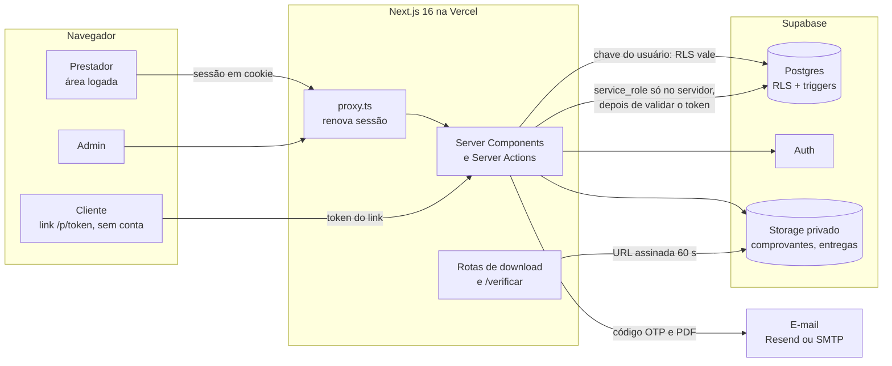

<p align="center">
  
</p>

<p align="center"><strong>Combinou? Registrou.</strong></p>

**Zelo** é uma plataforma web para prestadores de serviço (reformas, assistência técnica,
instalação, design e agências) enviarem propostas, escopos e entregas para o cliente aprovar
online. O cliente abre o link no celular, sem criar conta, e confirma com um código enviado por
e-mail. O aceite fica registrado com **trilha de auditoria** e **hash SHA-256 do documento**, o que
dá ao prestador uma prova do que foi combinado.

> Projeto acadêmico do curso de Análise e Desenvolvimento de Sistemas).

## Problemas que resolve

- Escopo mal definido ("eu não pedi isso").
- Combinados perdidos no WhatsApp.
- Cobrança de extras contestada e contestação na entrega.
- Orçamentos com pouca cara de profissional.

## Como funciona

1. O prestador monta a proposta a partir de um modelo do seu ramo: escopo, itens, o que **não**
   está incluso, valores, prazo, pagamento e garantia.
2. Envia o link pelo WhatsApp (botão `wa.me`) ou copia o link.
3. O cliente lê no celular e aceita, recusa ou pede ajuste, confirmando a identidade com um código
   de 6 dígitos enviado por e-mail.
4. O sistema gera um PDF comprovante com a trilha de auditoria e envia uma cópia aos dois.
5. Mudanças durante o serviço viram **aditivos**, e a conclusão vira um **aceite de entrega**
   (checklist e fotos), pelo mesmo fluxo.
6. Qualquer pessoa com o código do comprovante confere a autenticidade em `/verificar`: o sistema
   recalcula o hash do documento e, se o PDF for informado, compara com o arquivo original.

## Andamento

O desenvolvimento segue fases revisadas uma a uma ([plano completo](docs/PLANO.md)).

| Fase | Conteúdo | Situação |
|---|---|---|
| 0 | Fundação: Next.js, Tailwind, shadcn/ui, identidade visual | ✅ Concluída |
| 1 | Banco de dados: tabelas, RLS, triggers de imutabilidade, seeds | ✅ Concluída |
| 2 | Autenticação, papéis, recuperação de senha, conta suspensa | ✅ Concluída |
| 3 | Design system e shell do app (desktop e celular) | ✅ Concluída |
| 4 | Propostas: listagem, assistente de criação, rascunho, versões | ✅ Concluída |
| 5 | Envio: hash da versão, token do link, WhatsApp | ✅ Concluída |
| 6 | Página pública do cliente com aceite por código (OTP) | ✅ Concluída |
| 7 | PDF comprovante, e-mail e verificação de integridade | ✅ Concluída |
| 8 | Aditivo e aceite de entrega (com fotos) | ✅ Concluída |
| 9 | Painel do administrador | ✅ Concluída |
| 10 | Qualidade, acessibilidade, CI, keep-alive e deploy na Vercel | ✅ Concluída (deploy: ver [guia](docs/DEPLOY.md)) |

## Arquitetura



- **O banco é a última barreira.** Cada regra importante (quem vê o quê, versão enviada não
  muda, aceite e trilha append-only, aceite só com o hash certo) está no Postgres, em RLS e
  triggers. A aplicação valida antes para dar mensagens claras, mas não é a única defesa.
- **Três camadas de autorização:** `proxy.ts` (redirecionamento otimista e renovação da sessão),
  a camada de acesso a dados `lib/auth/dal.ts` (papel e conta suspensa, em cada página e ação) e o
  RLS no banco.
- **O cliente não tem conta.** Tudo o que ele faz passa pelo servidor: o token do link é validado
  e só então a `service_role` é usada, sempre em arquivos `server-only`.
- **Um fluxo, três documentos.** Proposta, aditivo e aceite de entrega usam as mesmas tabelas
  (`propostas.tipo` + `proposta_pai_id`), o mesmo envio, a mesma página do cliente e o mesmo
  comprovante; só os textos mudam (`lib/tipos.ts`).

### Ciclo de um documento

1. **Rascunho:** o assistente salva sozinho (autosave com debounce) e o servidor normaliza o
   conteúdo (total recalculado, valores em centavos).
2. **Envio:** o servidor relê o rascunho do banco, valida tudo de novo e monta o documento selado
   (conteúdo + retrato das partes + identidade do registro). Uma função do banco, numa transação,
   trava a versão, grava o SHA-256 da serialização canônica, troca o token do link e registra o
   evento.
3. **Resposta do cliente:** código de 6 dígitos por e-mail; uma função do banco confere o código e
   grava aceite, status e trilha de uma vez. O aceite repete o hash da versão.
4. **Comprovante:** depois da resposta (`after()`), o PDF é gerado, guardado no Storage privado e
   enviado por e-mail aos dois. O download gera o PDF na hora se ainda não existir.

## Stack

| Camada | Tecnologia |
|---|---|
| Aplicação | Next.js 16 (App Router), React 19, TypeScript |
| Interface | Tailwind CSS v4, shadcn/ui (Radix) com tema próprio, lucide-react, Manrope e JetBrains Mono |
| Dados e autenticação | Supabase: PostgreSQL, Row Level Security, Auth e Storage |
| Validação | Zod |
| E-mail | Resend, com alternativa por SMTP (Gmail via nodemailer) |
| PDF | @react-pdf/renderer, com Manrope e JetBrains Mono embutidas |
| Testes | Vitest (unitários e banco), Playwright (navegador) e axe-core (acessibilidade) |
| Hospedagem | Vercel (plano Hobby) e GitHub Actions |

## Segurança e integridade

A prova só vale se não puder ser alterada. Por isso, as regras principais ficam **no banco**, e não
só no código da aplicação:

- **Imutabilidade:** triggers bloqueiam `UPDATE`, `DELETE` e `TRUNCATE` nos aceites e na trilha de
  auditoria, e uma versão de proposta fica travada depois de enviada. Os triggers valem até para a
  chave de serviço do servidor, que ignora o RLS.
- **Aceite não pode ser forjado:** o status "aceita" só existe se houver o registro do cliente, para
  a versão atual, dentro da validade e com o hash igual ao do documento.
- **RLS em todas as tabelas:** um prestador não enxerga nada de outro; o visitante sem login não
  acessa nenhuma tabela; o administrador vê só a lista de prestadores e as contagens.
- **Envio atômico e selado:** ao enviar, uma função do banco trava a versão, grava o hash SHA-256 do
  documento (conteúdo + retrato das partes), gera o link e registra o evento, tudo de uma vez. O
  servidor revalida tudo e o detalhe da proposta recalcula o hash para provar que nada mudou.
- **Cliente sem conta acessa só pelo servidor:** o link carrega um token aleatório de 32 bytes, e o
  banco guarda apenas o hash dele.
- **Código por e-mail (OTP):** 6 dígitos, guardado como HMAC-SHA256 amarrado à proposta e à ação
  (um código pedido para recusar não serve para aceitar), expira em 10 minutos, com no máximo 5
  tentativas, 3 códigos por hora e uso único.
- **Página do cliente protegida:** link inválido, inexistente ou substituído dão a mesma resposta;
  a URL com o token não vaza por referrer, não fica em cache e não é indexada; a abertura só é
  registrada pelo navegador de verdade (a prévia de link do WhatsApp não marca "visualizada").
- **Autorização em três camadas:** o `proxy.ts` redireciona quem não está logado, a camada de acesso
  a dados (`lib/auth/dal.ts`) confere papel e conta suspensa no servidor, e o banco aplica o RLS.
- **Fotos da entrega e PDFs em buckets privados:** acesso só por URL assinada de curta duração; o
  servidor só assina caminhos da pasta do prestador dono do documento. No envio, cada foto é
  conferida pelos primeiros bytes e o SHA-256 dela entra no documento selado.
- **Limite de taxa** (no próprio Postgres, com o HMAC do IP, nunca o IP) para abrir o link, pedir
  código, responder, baixar o comprovante e usar o `/verificar`.
- **Cabeçalhos de segurança:** `X-Frame-Options`, CSP com `frame-ancestors 'none'`,
  `Permissions-Policy`, `nosniff`; na página do cliente, `no-referrer`, `no-store` e `noindex`.
- **Outros cuidados:** Zod em toda entrada (inclusive argumentos de Server Actions), proteção contra redirecionamento aberto, mensagens de
  login que não revelam se o e-mail existe, CPF mascarado na interface e segredos só em variáveis de
  ambiente.

As decisões de arquitetura, com o motivo de cada uma, estão em [`CLAUDE.md`](CLAUDE.md).

## Como rodar localmente

### Pré-requisitos

- Node.js 22 ou mais recente
- Docker (para o Supabase local)
- Google Chrome (usado pelos testes de navegador no ambiente local)

### Passo a passo

```bash
# 1. Instale as dependências
npm install

# 2. Suba o Supabase local (Postgres, Auth, Storage e Mailpit no Docker)
npm run db:start

# 3. Crie o arquivo de ambiente e preencha com os valores do Supabase local
cp .env.example .env.local
npx supabase status        # mostra a URL e as chaves locais

# 4. Aplique as migrations e os modelos de proposta
npm run db:reset

# 5. (Opcional) Crie o administrador, com SEED_ADMIN_* definidos no .env.local
npm run db:seed-admin

# 6. Rode o app
npm run dev
```

Endereços locais:

| Serviço | URL |
|---|---|
| Aplicação | http://localhost:3000 |
| Supabase Studio (banco) | http://127.0.0.1:54323 |
| Mailpit (e-mails enviados no ambiente local) | http://127.0.0.1:54324 |
| Vitrine de componentes (só em desenvolvimento) | http://localhost:3000/dev/componentes |

No ambiente local, use `EMAIL_PROVIDER=smtp` apontando para o Mailpit (`127.0.0.1:54325`): nenhum
e-mail é entregue de verdade e todos aparecem no Mailpit.

### Variáveis de ambiente

A lista completa, sem valores, está em [`.env.example`](.env.example). Nunca commite o `.env.local`.
Em produção, as variáveis são configuradas no painel da Vercel.

| Variável | Onde é usada |
|---|---|
| `NEXT_PUBLIC_SUPABASE_URL`, `NEXT_PUBLIC_SUPABASE_PUBLISHABLE_KEY` | Navegador e servidor (chave pública, limitada pelo RLS) |
| `NEXT_PUBLIC_APP_URL` | Montagem dos links enviados |
| `SUPABASE_SERVICE_ROLE_KEY` | Só no servidor (ignora o RLS) |
| `HASH_PEPPER` | Segredo do HMAC dos códigos e tokens |
| `EMAIL_PROVIDER`, `EMAIL_FROM`, `RESEND_API_KEY`, `SMTP_*` | Envio de e-mails |
| `SEED_ADMIN_EMAIL`, `SEED_ADMIN_PASSWORD` | Script de criação do administrador |

## Scripts

| Comando | O que faz |
|---|---|
| `npm run dev` | Servidor de desenvolvimento |
| `npm run build` / `npm start` | Build e servidor de produção |
| `npm run lint` | ESLint |
| `npm run typecheck` | Gera os tipos de rota do Next e roda o TypeScript |
| `npm test` | Testes unitários |
| `npm run test:db` | Testes do banco: RLS, imutabilidade e seeds (exige o Supabase local) |
| `npm run test:e2e` | Testes no navegador, em desktop e celular de 375px |
| `npm run check` | Tudo acima, em sequência |
| `npm run format` | Prettier |
| `npm run db:start` / `db:stop` | Liga e desliga o Supabase local |
| `npm run db:reset` | Recria o banco local com migrations e seed |
| `npm run db:types` | Regenera os tipos TypeScript a partir do banco |
| `npm run db:advisors` | Verificações de segurança e desempenho do Supabase |
| `npm run db:seed-admin` | Cria ou promove o administrador |

## Qualidade

| Verificação | Resultado |
|---|---|
| Testes unitários (Vitest) | 191 testes: validação, hash canônico, OTP, máscaras, textos por tipo, PDF |
| Testes de banco (Vitest + Supabase local) | 104 testes: RLS entre prestadores, imutabilidade, append-only, envio, resposta do cliente, buckets privados |
| Testes no navegador (Playwright) | fluxos completos em desktop e em 375px: cadastro e login, assistente, envio, aceite com código, comprovante, aditivo, entrega com fotos, verificação, administração |
| Acessibilidade (axe-core, WCAG 2.1 AA) | sem violações nas telas principais, em desktop e 375px |
| Lighthouse mobile em `/p/[token]` | Desempenho 100, Acessibilidade 100, Boas práticas 100 (SEO 63 de propósito: o link é pessoal e tem `noindex`) |
| Advisors de segurança do Supabase | sem problemas, exceto o aviso aceito na decisão D33 |
| `npm audit --omit=dev` | 0 vulnerabilidades nas dependências de produção |

Para conferir que os testes de banco detectam falhas de verdade, as proteções foram removidas de
propósito num teste de mutação, e os testes quebraram como esperado.

### Integração contínua (GitHub Actions)

- [`ci.yml`](.github/workflows/ci.yml), a cada push e pull request: lint, tipos, testes unitários e
  build; depois sobe o **Supabase local no próprio runner** (Docker) e roda os testes de banco e
  de navegador. Nenhum segredo de produção é usado.
- [`keep-alive.yml`](.github/workflows/keep-alive.yml), a cada 3 dias: chama a função `ping()` do
  banco com a chave pública, para o plano gratuito do Supabase não pausar o projeto. Precisa dos
  secrets `SUPABASE_URL` e `SUPABASE_PUBLISHABLE_KEY` no repositório.

## Deploy

O passo a passo (Vercel, variáveis de ambiente, configuração do Supabase na nuvem, e-mail e
criação do administrador) está em [`docs/DEPLOY.md`](docs/DEPLOY.md).

## Estrutura

```
app/                     rotas: (auth) acesso, (app) prestador, (admin) administração,
                         p/[token] página do cliente, verificar/ verificação pública
components/ui/           componentes shadcn/ui com o tema da Zelo
components/zelo/         componentes da marca (selo de aceite, documento, assistente, shell)
components/publico/      página do cliente (resposta, cabeçalho)
lib/auth/                sessão, papéis e ações de acesso
lib/proposals/           rascunho, envio, consultas e ações de propostas, aditivos e entregas
lib/publico/             página do cliente: token, OTP, consentimento, limite de taxa
lib/comprovante/, lib/pdf/  dados e geração do PDF
lib/crypto/              JSON canônico, SHA-256, HMAC, token do link
lib/email/               interface de e-mail (Resend ou SMTP) e modelos
supabase/migrations/     esquema do banco versionado (tabelas, RLS, triggers, funções, storage)
supabase/seed.sql        5 modelos de proposta, um por ramo
supabase/templates/      e-mails de autenticação em português
tests/                   unit/, db/ e e2e/
.github/workflows/       CI e keep-alive
docs/                    plano das fases e guia de deploy
DESIGN.md                identidade visual e diretrizes de interface
CLAUDE.md                resumo técnico e registro de decisões (D1 a D87)
```

## Decisões principais

O registro completo, com o motivo de cada escolha, está em [`CLAUDE.md`](CLAUDE.md). As que mais
pesam:

- **Valores em centavos e JSON canônico** para que o hash de um documento seja sempre o mesmo, até
  depois de passar pelo `jsonb` do Postgres (D14, D52).
- **O hash cobre o documento enviado inteiro:** conteúdo, retrato das partes (se o prestador mudar
  de nome depois, a prova continua), id da proposta e número da versão; no aditivo e na entrega,
  também a referência à proposta original e, na entrega, o SHA-256 de cada foto (D52, D77, D80).
- **HMAC com segredo (`HASH_PEPPER`)** para o token do link e o código OTP: sem o segredo, quem
  vazasse o banco não conseguiria testar os 10⁶ códigos possíveis (D9).
- **Funções do banco para envio e resposta:** tudo ou nada numa transação (D53, D63).
- **OTP por e-mail e link por `wa.me`:** sem custo; a API oficial do WhatsApp é paga (D1, D2).
- **A abertura do link é registrada pelo navegador**, não pelo servidor, para a prévia do WhatsApp
  não marcar a proposta como visualizada (D62).

## Limitações conhecidas

- **E-mail:** sem domínio próprio verificado, o Resend só entrega para o dono da conta. Para
  demonstrações com clientes reais, use o provedor SMTP (Gmail com senha de app, ~500 e-mails/dia).
- **IP na trilha:** vem do cabeçalho `x-forwarded-for`, confiável só hospedado na Vercel. Fora
  dela, o limite de taxa por IP deixa de valer (o limite por proposta continua) (D60).
- **Fotos removidas de um rascunho de entrega continuam no bucket:** o prestador não tem permissão
  de apagar (foto anexada é prova e pode estar citada numa versão enviada) (D83).
- **PDF:** só fotos JPEG e PNG são embutidas (WebP aparece listada, com o hash); emoji e alguns
  símbolos viram "?" no PDF, que usa fontes embutidas (o documento guardado não muda) (D71, D82).
- **Recusa e pedido de ajuste** não geram e-mail para o prestador; ele vê no painel.
- **CSP parcial:** sem política de scripts com nonce (exigiria renderização dinâmica em todo o
  site).
- **Keep-alive:** o GitHub desativa agendamentos de repositórios sem atividade por 60 dias.
- **Plano gratuito:** 500 MB de banco e 1 GB de Storage no Supabase; 100 e-mails/dia no Resend.
- **Dependências de desenvolvimento** (ESLint e a CLI do shadcn) têm avisos moderados no
  `npm audit`; nenhuma vai para produção.
- Sem modo escuro e sem contas com vários usuários por empresa no MVP.

## Evolução futura

- Domínio próprio, com e-mail verificado (SPF/DKIM) e notificações ao prestador a cada resposta.
- Carimbo de tempo de uma autoridade (RFC 3161) ou assinatura com certificado ICP-Brasil no PDF,
  para reforçar o valor jurídico.
- Equipes: vários usuários por empresa, com papéis.
- Envio automático pelo WhatsApp (API oficial) e código por SMS.
- Cobrança integrada (Pix) a partir da proposta aceita.
- Limpeza programada das fotos órfãs e CSP completa com nonce.
- Painel com métricas (taxa de aceite, tempo até a resposta) e exportação dos dados (LGPD:
  portabilidade e exclusão a pedido do titular).
